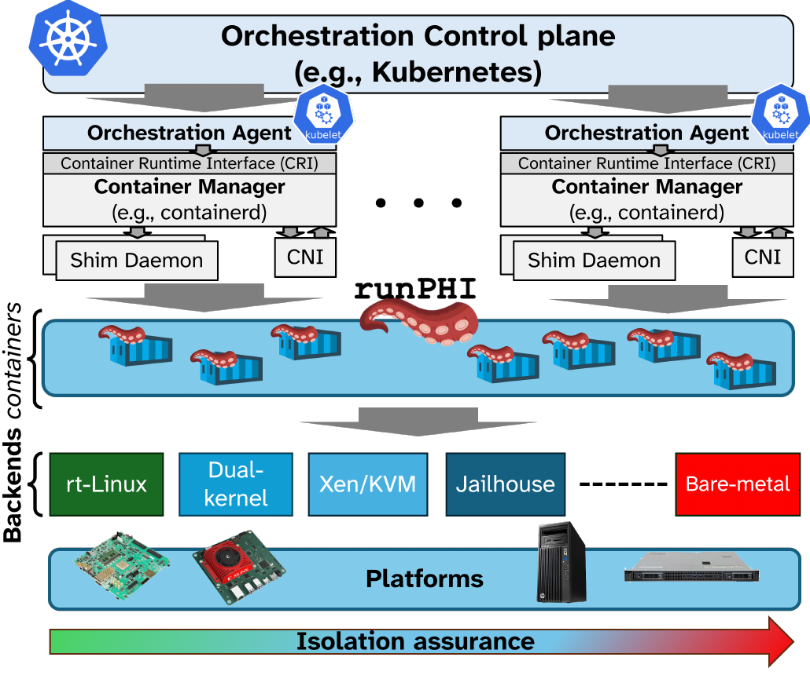

<p>
  
  <h2>runPHI: A Container RUNtime for Partitioning Hypervisor Integration</h2>
</p>

**runPHI** is an OCI-compliant *meta-runtime* that orchestrates heterogeneous
execution environments, from ordinary Linux containers to hardware-partitioned
bare-metal guests, through the same standard container workflows (Docker,
containerd, Kubernetes) across the cloud–edge continuum.

Industrial applications (Industry 4.0/5.0) mix workloads of different
criticality on the same nodes, and safety standards (ISO 26262, EN 50128,
DO-178C) demand freedom from interference between them. Linux containers and
microVMs share the host kernel, so they cannot guarantee it; partitioning
hypervisors and separation kernels can, but they need board-specific
configuration and manual integration, out of reach of cloud-native tools.

runPHI closes this gap. It sits where `runc` sits, below the container
manager's shim, and translates each OCI lifecycle command (`create`, `start`,
`kill`, `delete`, `state`) into the actions and configuration of the chosen
backend. Each isolation technology becomes a first-class OCI citizen, and the
orchestrator deploys and manages them all as containers:

- **Linux containers**, standard or real-time, for non-critical workloads (handed to `runc`);
- **hypervisor-based containers**, virtual machines of a general-purpose
  hypervisor (Xen, KVM), for mid-to-high isolation;
- **partitioned containers (p-containers)**, an application with a minimal
  runtime (an RTOS such as Zephyr or FreeRTOS, a libOS, or bare metal) on a
  static partition of a partitioning hypervisor (Jailhouse), down to the
  real-time processing units (RPUs) of the SoC, for the strictest real-time
  and dependability requirements.

<p align="center">
  
</p>

Because the same application can be packaged for several backends and the
image builder picks, at pull time, the variant each node can run, runPHI
enables orchestration primitives that no single backend offers: **diverse
replication**, with replicas of a service on different isolation
technologies, and **cross-backend migration**, re-provisioning a failing or
degraded workload on another backend. An environment builder assembles
tested, reproducible combinations of toolchains, kernels, RTOSes and
hypervisors for each platform.

The direction of the project is a single cloud-native control plane for any
execution environment an industrial node can offer, with the isolation level
chosen per workload: more backends (KVM, other partitioning hypervisors,
dual-kernel setups), more platforms (Arm and x86), and orchestration policies
that use the diversity among them for resilience.

runPHI is an academic research project.

## Repositories

| Repository | Content |
|---|---|
| [runphi_manager](https://github.com/runphi/runphi_manager) | the runtime (Rust), with its backends |
| [environment_builder](https://github.com/runphi/environment_builder) | builds and deploys complete environments (firmware, kernel, rootfs, hypervisor, runPHI) for each board and backend, in Docker |
| [partitioned_container_demos](https://github.com/runphi/partitioned_container_demos) | example partitioned containers |

## Backends and platforms

| Backend | Platforms (environment_builder) |
|---|---|
| Jailhouse | AMD Kria KV260 and KR260, ZCU102, ZCU104, Trenz TEBF0808, QEMU |
| Xen | ZCU104 |
| KVM | AMD Kria KV260, Orange Pi 5 Plus (RK3588) |

## Try it without a board

The `qemu-jailhouse` environment runs Jailhouse, its root cell and Linux and
Zephyr cells in QEMU, on any Linux PC with Docker:

```sh
git clone https://github.com/runphi/environment_builder.git && cd environment_builder
docker build -t env_builder .
docker run -it --rm --user $(id -u):$(id -g) -v /etc/passwd:/etc/passwd:ro --net=host \
  -v ${PWD}:/home -w=/home env_builder ./scripts/build_environment.sh -t qemu -b jailhouse
./scripts/qemu/start_qemu.sh -t qemu -b jailhouse    # login: root / root
```

Then follow [the demos](https://github.com/runphi/environment_builder/blob/main/environment/qemu/jailhouse/DEMO.md).

## Papers

- D. Ottaviano, M. Barletta, F. Boccola, "Zero-Interference Containers: A
  Framework to Orchestrate Mixed-Criticality Applications," *DSN 2025*,
  [doi:10.1109/DSN64029.2025.00064](https://doi.org/10.1109/DSN64029.2025.00064)
- M. Barletta, F. Boccola, M. Cinque, L. De Simone, R. Della Corte,
  D. Ottaviano, "Integrating Containers and Partitioning Hypervisors for
  Dependable Real-time Industrial Clouds," *RT-Cloud 2024 workshop at ECRTS*,
  [pdf](https://archives.ecrts.org/fileadmin/WebsitesArchiv/ecrts2024/wp-content/uploads/2024/07/Integrating-Containers-and-Partitioning-Hypervisors.pdf)
- M. Barletta, M. Cinque, L. De Simone, R. Della Corte, G. Farina,
  D. Ottaviano, "Partitioned Containers: Towards Safe Clouds for Industrial
  Applications," *DSN-S 2023*, pp. 84–88,
  [doi:10.1109/DSN-S58398.2023.00029](https://doi.org/10.1109/DSN-S58398.2023.00029)
- M. Barletta, M. Cinque, L. De Simone, R. Della Corte, G. Farina,
  D. Ottaviano, "RunPHI: Enabling Mixed-criticality Containers via
  Partitioning Hypervisors in Industry 4.0," *ISSRE Workshops 2022*,
  pp. 134–135, [arXiv:2209.01843](https://arxiv.org/abs/2209.01843)

## Authors

Francesco Boccola, Marco Barletta, Daniele Ottaviano, Luigi De Simone and
other members of the [DESSERT group](https://dessert.unina.it) at
[DIETI](http://www.dieti.unina.it), Università degli Studi di Napoli
Federico II.

Suggestions and contributions are welcome: write to
[runphi.dessert.unina@gmail.com](mailto:runphi.dessert.unina@gmail.com).
