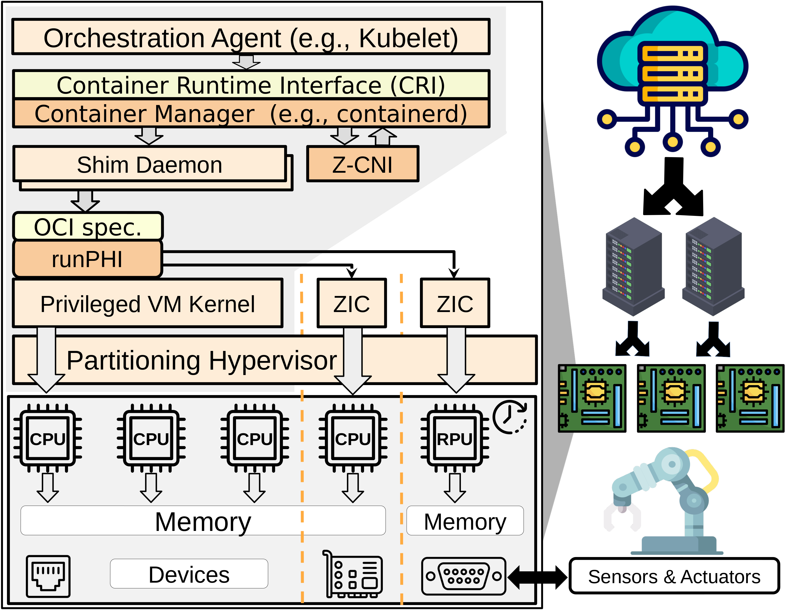

<p>
  
  <h2>runPHI: A Container RUNtime for Partitioning Hypervisor Integration</h2>
</p>

**runPHI** is an OCI container runtime that runs containers as partitions of a
hypervisor. A container runtime is the small program below containerd, Docker
or the kubelet that sets up and starts a container; runPHI does the same with
partitioning hypervisors, designed for industrial systems with real-time and
safety requirements.

With runPHI, a Zephyr, FreeRTOS, bare-metal or Linux workload running on
industrial hardware (real-time processing units included) is deployed and
managed by Docker or Kubernetes like any other container, while running
isolated in its own partition: a **Zero-Interference Container** (ZIC).
Images without a partition configuration go to `runc` as usual, so critical
and ordinary containers share the same cluster and tools.

<p align="center">
  
</p>

runPHI implements the basic OCI calls (`create`, `start`, `kill`, `delete`,
`state`). It is an academic research project.

## Repositories

| Repository | Content |
|---|---|
| [runphi_manager](https://github.com/runphi/runphi_manager) | the runtime (Rust), with its backends |
| [environment_builder](https://github.com/runphi/environment_builder) | builds and deploys complete environments (firmware, kernel, rootfs, hypervisor, runPHI) for each board and backend, in Docker |
| [partitioned_container_demos](https://github.com/runphi/partitioned_container_demos) | example partitioned containers |

## Backends and platforms

| Backend | Platforms (environment_builder) |
|---|---|
| Jailhouse | AMD Kria KV260 and KR260, ZCU102, ZCU104, Trenz TEBF0808, QEMU |
| Xen | ZCU104 |
| KVM | AMD Kria KV260, Orange Pi 5 Plus (RK3588) |

## Try it without a board

The `qemu-jailhouse` environment runs Jailhouse, its root cell and Linux and
Zephyr cells in QEMU, on any Linux PC with Docker:

```sh
git clone https://github.com/runphi/environment_builder.git && cd environment_builder
docker build -t env_builder .
docker run -it --rm --user $(id -u):$(id -g) -v /etc/passwd:/etc/passwd:ro --net=host \
  -v ${PWD}:/home -w=/home env_builder ./scripts/build_environment.sh -t qemu -b jailhouse
./scripts/qemu/start_qemu.sh -t qemu -b jailhouse    # login: root / root
```

Then follow [the demos](https://github.com/runphi/environment_builder/blob/main/environment/qemu/jailhouse/DEMO.md).

## Papers

- D. Ottaviano, M. Barletta, F. Boccola, "Zero-Interference Containers: A
  Framework to Orchestrate Mixed-Criticality Applications," *DSN 2025*,
  [doi:10.1109/DSN64029.2025.00064](https://doi.org/10.1109/DSN64029.2025.00064)
- M. Barletta, F. Boccola, M. Cinque, L. De Simone, R. Della Corte,
  D. Ottaviano, "Integrating Containers and Partitioning Hypervisors for
  Dependable Real-time Industrial Clouds," *RT-Cloud 2024 workshop at ECRTS*,
  [pdf](https://archives.ecrts.org/fileadmin/WebsitesArchiv/ecrts2024/wp-content/uploads/2024/07/Integrating-Containers-and-Partitioning-Hypervisors.pdf)
- M. Barletta, M. Cinque, L. De Simone, R. Della Corte, G. Farina,
  D. Ottaviano, "Partitioned Containers: Towards Safe Clouds for Industrial
  Applications," *DSN-S 2023*, pp. 84–88,
  [doi:10.1109/DSN-S58398.2023.00029](https://doi.org/10.1109/DSN-S58398.2023.00029)
- M. Barletta, M. Cinque, L. De Simone, R. Della Corte, G. Farina,
  D. Ottaviano, "RunPHI: Enabling Mixed-criticality Containers via
  Partitioning Hypervisors in Industry 4.0," *ISSRE Workshops 2022*,
  pp. 134–135, [arXiv:2209.01843](https://arxiv.org/abs/2209.01843)

## Authors

Francesco Boccola, Marco Barletta, Daniele Ottaviano, Luigi De Simone and
other members of the [DESSERT group](https://dessert.unina.it) at
[DIETI](http://www.dieti.unina.it), Università degli Studi di Napoli
Federico II.

Suggestions and contributions are welcome: write to
[runphi.dessert.unina@gmail.com](mailto:runphi.dessert.unina@gmail.com).
